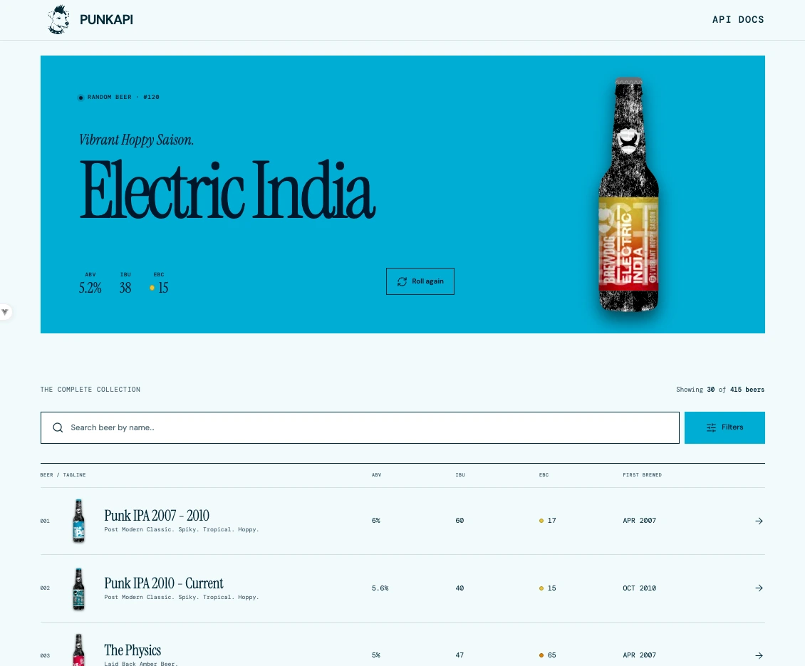

# PunkVue

A frontend for [PunkAPI](https://github.com/alxiw/punkapi) — a browsable digital archive of brewing recipes for
all 415 beers of BrewDog's DIY Dog V8.

### 🔗 [punkapi.dev](https://punkapi.dev/)



## Features

- Catalog of all 415 beers with infinite-scroll pagination (30 items per page).
- Filters: beer name, food pairing, ABV / IBU / EBC ranges, brewing date range.
- Random beer banner above the catalog.
- Recipe sheet opens on top of the catalog, so filters, loaded pages and scroll position survive
  opening and closing it.
- Deep links: `/`, `/:id` (e.g. `/366`), plus a custom 404 screen.
- Light/dark theme via `prefers-color-scheme` and native CSS custom properties (no external UI/CSS framework).

## Tech stack

- **Frontend:** [Vue 3](https://github.com/vuejs/core), [TypeScript](https://github.com/microsoft/TypeScript), [Vite 8](https://github.com/vitejs/vite)
- **Routing & Network:** [Vue Router 4](https://github.com/vuejs/router), [Axios](https://github.com/axios/axios)
- **Styling:** [Vanilla CSS](https://developer.mozilla.org/en-US/docs/Web/CSS)
- **UI & Icons:** [Lucide Icons](https://github.com/lucide-icons/lucide)
- **Testing:** [Vitest](https://github.com/vitest-dev/vitest)

## Requirements

- Node.js `^20.19.0 || >=22.12.0` (Vite 8 engine requirement)
- pnpm 9+ (`pnpm-lock.yaml`, lockfile v9)

## Getting started

```bash
pnpm install
cp .env.example .env   # API base URL
pnpm dev               # http://localhost:5173
```

## Environment variables

| Variable            | Required | Description                                     |
| ------------------- | -------- | ----------------------------------------------- |
| `VITE_API_BASE_URL` | yes      | PunkAPI base URL, e.g. `https://punkapi.dev/v3` |

Trailing slashes in `VITE_API_BASE_URL` are stripped, so `/v3` and `/v3/` are equivalent.

Notes:

- `.env` is **not tracked by git** (see `.gitignore`); `.env.example` is the template to copy.
- `VITE_*` variables are **inlined into the bundle at build time**, so they are public by
  definition and must be present for every build (local, CI, Docker). Never put secrets there.
- Without `VITE_API_BASE_URL` requests fall back to the app's own origin, so a bundle built
  without it cannot reach the API.

## Scripts

| Command           | Description                                               |
| ----------------- | --------------------------------------------------------- |
| `pnpm dev`        | Dev server with HMR                                       |
| `pnpm build`      | Type-check (`vue-tsc -b`) + production build into `dist/` |
| `pnpm preview`    | Serve the built `dist/` locally                           |
| `pnpm test`       | Run unit tests once                                       |
| `pnpm test:watch` | Unit tests in watch mode                                  |
| `pnpm type-check` | Type-check only                                           |

## Project structure

```text
src/
├── api/           axios client, PunkAPI requests, DTO + mapper
├── components/    banner/, catalog/, layout/, recipe/, screens/
├── composables/   catalog state, recipe state, random beer, image loading, infinite scroll
├── router/        routes: /, /:id, 404
├── types/         domain types
├── utils/         EBC colour scale, formatters
├── App.vue        app shell + recipe sheet host
└── main.ts        bootstrap
```

## Testing

```bash
pnpm test
```

Vitest specs (`src/**/*.spec.ts`) cover PunkAPI query building, the API → domain mapper and the
image-loading composable.

## Deployment

The app is a static SPA: everything the server needs is in `dist/`.

1. `pnpm build`. `VITE_API_BASE_URL` must be available **during the build**, because the value is
   baked into the bundle: use `.env` for a local build and a repository variable / job env
   (`VITE_API_BASE_URL`) in CI. The build aborts when the variable is missing.
2. The production server needs **no `.env` file** — it only serves the built assets.
3. History mode (`/366` is a client-side route) needs a server fallback to `index.html`; the
   bundled `nginx.conf` already does this. For any other server:

   ```nginx
   location / {
     try_files $uri $uri/ /index.html;
   }
   ```

4. Serving under a sub-path requires Vite's `base`; the router already reads it through
   `import.meta.env.BASE_URL`.

### Docker

```bash
docker build --build-arg VITE_API_BASE_URL=https://punkapi.dev/v3 -t punkvue .
docker run --rm -p 8080:80 punkvue   # http://localhost:8080
```

- The image is multi-stage: `node:24-alpine` type-checks and bundles the app, `nginx:stable-alpine`
  serves `dist/` (~93 MB in total).
- `--build-arg` is mandatory, not optional: the URL is inlined into the bundle, so `-e` or
  `.env` at runtime has no effect, and the Docker build fails at `pnpm build` without the argument.
- `.dockerignore` keeps `.env*`, `node_modules`, `dist`, `.git` and OS files out of the build
  context, so the API URL never leaks into an image layer.
- `nginx.conf` provides the history fallback, one year of caching for content-hashed `/assets/`,
  30 days for icons and the manifest (served as `application/manifest+json`), `no-cache` for
  `index.html`, gzip and the basic security headers.

## License

[MIT](LICENSE) © [alxiw](https://github.com/alxiw)
